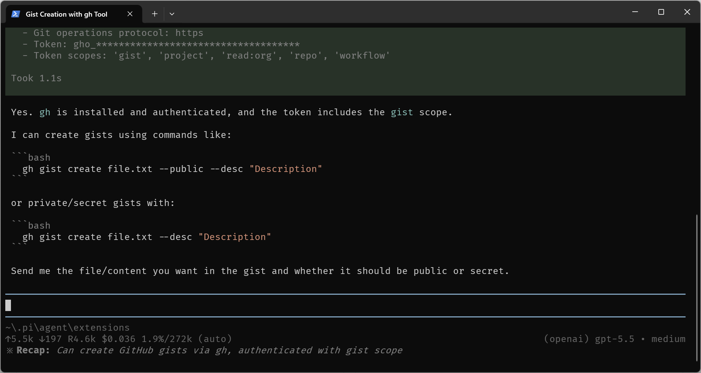

# pi-recap

Small [pi](https://pi.dev) extension that updates the terminal tab title and shows an italic recap in the status bar after each interaction.

By default, it uses `openai/gpt-5-nano` for the title and recap.

<p>
  
</p>

## Installation

Install as a pi package:

```bash
pi install git:https://github.com/Dovyski/pi-recap
```

Or copy `extensions/recap.ts` into `~/.pi/agent/extensions/recap.ts` and run `/reload`.

## Configuration

Configure the prompts and recap truncation in `~/.pi/agent/settings.json` or a project-local `.pi/settings.json`:

```json
{
  "recap": {
    "model": "openai/gpt-5-nano",
    "maxWords": 14,
    "prompts": {
      "title": "You write concise terminal tab titles for coding-agent sessions. Output only a specific 2-6 word title. Do not quote or closely reuse the user's wording.",
      "recap": "Write a concise terminal status recap for the session. Output only one natural phrase or sentence, at most 14 words. Do not start with phrases like 'The user asks', 'The user requested', or 'This session'. Avoid mentioning participants. Focus on the concrete capability, decision, or result."
    }
  }
}
```

- `recap.model` selects the model used for title and recap generation, in `provider/model` format.
- `recap.maxWords` controls local truncation of the recap text.
- `recap.prompts.title` controls title generation.
- `recap.prompts.recap` controls recap generation.

Run `/reload` after changing extension files or settings.

## License

MIT
